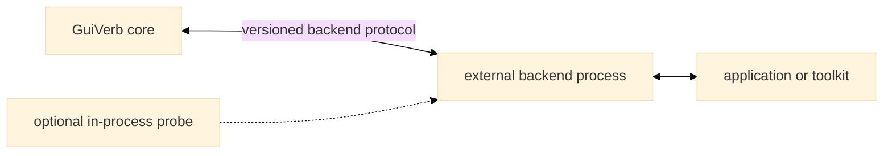
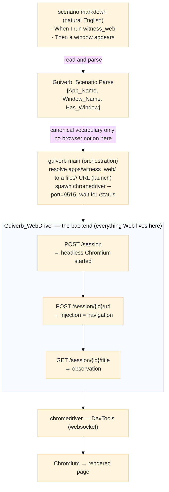
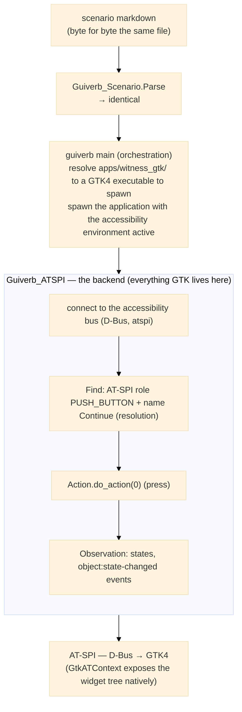
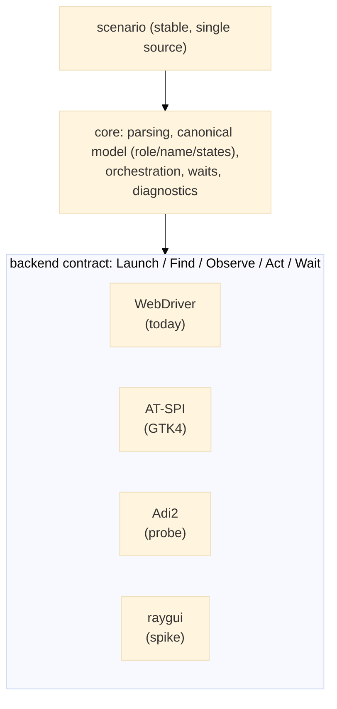
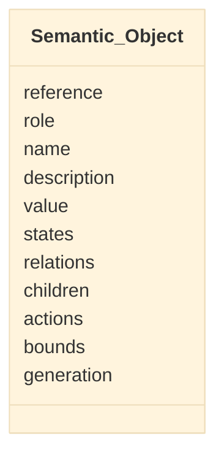
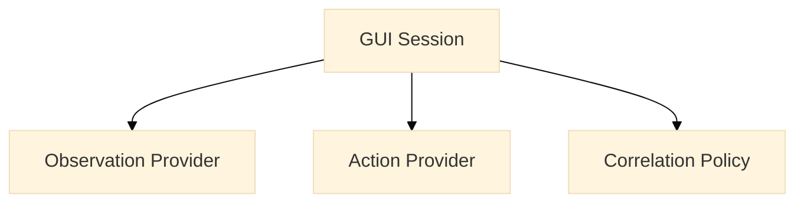
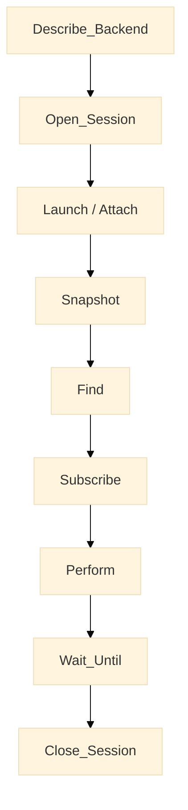

# Architecture <!-- omit from toc -->

## Contents <!-- omit from toc -->

- [Project boundary with `bbt`](#project-boundary-with-bbt)
- [Core boundary](#core-boundary)
- [Execution flows](#execution-flows)
- [Canonical semantic object](#canonical-semantic-object)
- [Observation and action](#observation-and-action)
- [Logical backend contract](#logical-backend-contract)
- [Object resolution](#object-resolution)
- [Temporal semantics](#temporal-semantics)
- [Protocol frontier](#protocol-frontier)

## Project boundary with `bbt`

GuiVerb is architecturally separate from `bbt`.

|  | bbt | GuiVerb |
|---|---|---|
| Role | CLI behaviour runner | GUI behaviour design and execution |
| Core | stable | experimental backends and protocol |
| Dependencies | no GUI dependencies | platform-specific GUI adaptors |
| Release | independent release path | independent release path |

Permitted integration directions include invoking the `bbt` executable, reusing a stable parser/library if one is intentionally exposed, or exchanging documented scenario/results files. GuiVerb must not require GUI-specific code inside the `bbt` core.

## Core boundary



## Execution flows

One scenario file, two backends. The script never carries platform
knowledge (S001); the backend is selected on the command line and owns
its own machinery, from launch to shutdown.

### Flow on the Web backend (implemented, F005)



For a future `press the Continue button` step (F020), the same chain
adds two backend steps: resolve (role `button` + accessible name
`Continue` -> element reference; the role+name to locator mapping is
invisible to the scenario), then act (`Element Click`, which injects
real input events). The scenario never says `click`, `css=`, or
`websocket`: it says `press the Continue button`.

### Flow on the GTK4 backend (projected)



GTK4 exposes its tree through AT-SPI without instrumentation: the
backend translates the canonical vocabulary to `libatspi`, it does not
modify the application (Adi2 and raygui are the intrusive targets).

### Layered view



The pivot is the canonical model (role + accessible name + states):
Web and GTK4 both expose it natively (ARIA/accname, AT-SPI). The
backend driver plays the same role in each chain: chromedriver is an
HTTP-to-browser translator; AT-SPI/D-Bus is a call-to-widget
translator. The injection level is a backend choice, not a scenario
choice (`press` may become `el.click()`, `do_action()`, or system
input) - which is what action provenance (F075) records.

## Canonical semantic object



ARIA is the primary ontology, not a backend API. Accessible name, visible text, technical identifier, and description remain distinct. Every property distinguishes known value, known absence, and unsupported or unknown.

## Observation and action



Action injection levels:

1. system input;
2. toolkit input;
3. semantic accessibility or automation action;
4. direct state manipulation.

No silent fallback occurs between these levels.

## Logical backend contract



## Object resolution

Initial rule:

```text
role + exact accessible name + optional ancestor scope
```

Zero results means not found. Multiple results means ambiguous. The engine never selects the first result silently.

## Temporal semantics

- `is visible` checks current state;
- `appears` checks an absent-to-present transition;
- `eventually appears` waits within a configured deadline;
- `appears within <duration>` / `after <duration>` asserts a duration
  that is itself a requirement: a session expiry, an auto-dismissed
  dialog, a state change expected at a given time.

Two kinds of timing coexist. Harness timing — the default deadline an
`eventually` form waits within — is configuration, set on the command
line or in a profile, and does not belong in ordinary behavioural
prose. Behavioural timing — durations the application promises — is a
requirement like any other, and scenarios are free to assert it.

## Protocol frontier

The protocol carries versions, capabilities, sessions, canonical snapshots, semantic references, changes, actions, actual injection level, structured errors, diagnostics, and attachment references.

Native handles, DOM nodes, CSS, XPath, AT-SPI object paths, and toolkit APIs remain backend-private. Parsing scenario English remains in `bbt`.
