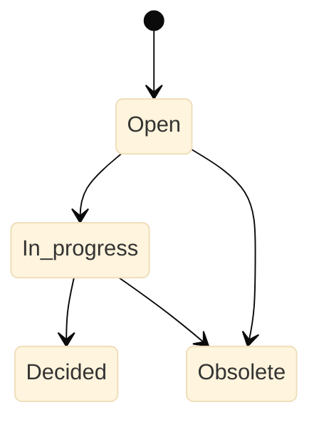

# Concerns <!-- omit from toc -->

This is a lightweight index, not a duplicate issue tracker. Each row
supplies an identifier, a priority, a short label, a kind, a status,
and the authoritative link; the details remain in the authoritative
source.

Open design questions are concerns of kind `Design`: the question is
the concern, and the recorded decision is its resolution. They keep
their `Qnnn` identifier for life; a number is never reused. When a
question is decided, record the decision in
`docs/dev/design_discussions.md` (or merge it into
`docs/architecture.md`), replace the Source `—` with a link to it, and
mark the row `Decided`. A question that no longer matters is marked
`Obsolete`, not deleted.

| Id | Priority | Concern | Kind | Status | Source |
|---|---|---|---|---|---|
| Q001 | P2 | Is `window` a canonical role? | Design | Open | — |
| Q002 | P2 | Is `screen` an object or an application-state alias? | Design | Open | — |
| Q003 | P2 | Which value types and ARIA relations belong in the MVP? | Design | Open | — |
| Q004 | P2 | Does `Find` belong to the backend or the core? | Design | Open | — |
| Q005 | P2 | Does launch reuse generic process management inherited from or delegated to `bbt`? | Design | Open | — |
| Q006 | P2 | What defines minimum backend conformance? | Design | Open | — |
| Q007 | P2 | Which correlation tokens may cross provider boundaries? | Design | Open | — |
| Q008 | P2 | Can fallback between action levels ever be automatic? | Design | Open | — |
| Q009 | P2 | What consistency is required between lookup and action? | Design | Open | — |
| Q010 | P2 | Do `a`, `an`, and `the` express cardinality? | Design | Open | — |
| Q011 | P2 | Is exact case-sensitive matching the default? | Design | Open | — |
| Q012 | P2 | Are partial and ordinal matching required? | Design | Open | — |
| Q013 | P2 | Does `appears` wait implicitly? | Design | Open | — |
| Q014 | P2 | How is a transition baseline captured? | Design | Open | — |
| Q015 | P2 | Do consecutive assertions share a deadline? | Design | Open | — |
| Q016 | P2 | Protocol transport: standard I/O or local socket? | Design | Open | — |
| Q017 | P2 | Protocol encoding: JSON, CBOR, or another? | Design | Open | — |
| Q018 | P2 | How are attachments transferred and versions negotiated? | Design | Open | — |
| Q019 | P2 | Can Adi2 expose sufficient semantics without core modification? | Design | Open | — |
| Q020 | P2 | Can raygui support identity, focus, and text entry with localised instrumentation? | Design | Open | — |
| Q021 | P2 | Web backend: Playwright or WebDriver/BiDi? | Design | Open | — |
| Q022 | P2 | How is a password field named in the vocabulary? ARIA has no password role; platforms expose a protected text field | Design | Open | — |
| Q023 | P2 | How does a run select and launch its backend? Strategy pattern with CLI selection; application-instance selection (GUIVERB_APP) and the server-application launcher (serve) are decided | Design | In progress | [Backend selection and launch](design_discussions.md#backend-selection-and-launch), [Application resolution and server applications](design_discussions.md#application-resolution-and-server-applications) |
| Q024 | P2 | A GtkAda4 application registers on the a11y bus as "Unnamed" despite its application id; GuiVerb's GTK backend works around it by pid-based correlation | Design | Open | [forum thread](https://forum.ada-lang.io/t/preview-testing-gtkada4-with-alire-on-ubuntu-26-04/4899) and `~/prj/gtkada4_test` probe |

All open questions are P2 for now: the project is in the
architectural-exploration phase, and nothing yet blocks a released
behaviour. Review the priorities when the corresponding phase starts.

## Statuses

## Adding a concern

- P1: blocks normal use, threatens correctness, breaks CI or release,
  or creates material risk;
- P2: important and actionable but not immediately blocking;
- P3: worthwhile maintenance or improvement with limited current impact.

Kinds: Bug, Debt, Design, Quality. The Source column points to the
authoritative place — an issue, a pull request, a proposal, a design
discussion, a generated report. A closed concern is removed or marked
closed according to the project's desired history policy.
